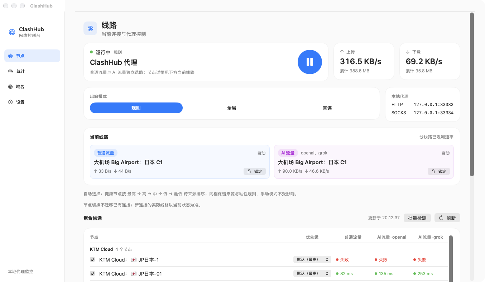
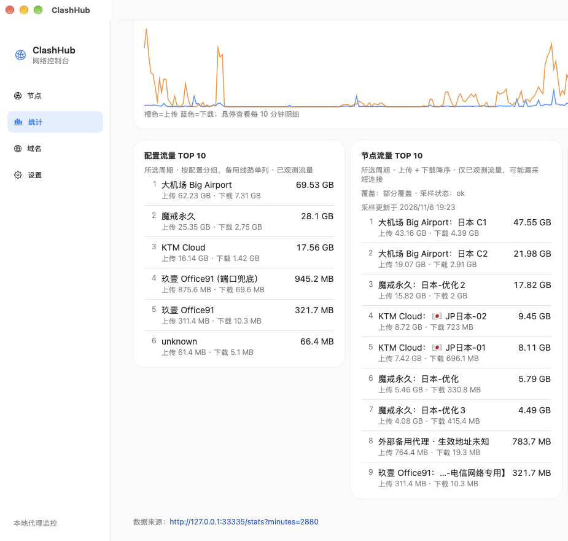

# ClashHub

[简体中文](README.md) · [English](README.en.md)

A macOS **region-specific node aggregator** and routing supervisor with a menu-bar console, **ClashHub**.

> **Platform: macOS 14+ only; there is no Windows or Linux build.** The daemon relies on macOS system-proxy and network-service APIs, and the GUI is SwiftUI.

ClashHub merges nodes from multiple Clash/FlClash profiles into one pool (Japan by default), selects a node by source priority and measured health, and splits traffic into two independent routes:

- **Ordinary traffic** (`主代理` selector internally): everything except the configured AI domains
- **AI traffic** (`AI主代理` selector internally): only the official domains of the selected AI providers (openai / claude / gemini / grok, multi-select)

A local fallback proxy (`127.0.0.1:7890` by default) is used only when every candidate has explicitly failed — not on the first hiccup.

## Screenshots





> Airports, nodes and traffic in the screenshots are examples; no subscription URLs or keys are shown.

## What it solves

A single region often spans several airports, subscriptions and client profiles. Keeping merged groups, priorities and failover rules in a GUI client is tedious and tends to flap. ClashHub turns that into one local supervisor:

- aggregates nodes of a **chosen region** from several sources and picks by source/node priority;
- uses existing profiles read-only — it never edits FlClash's database or configuration;
- routes ordinary and AI traffic separately, with separate health evidence and statistics;
- falls back only when all candidates fail, avoiding pointless switching.

The region is controlled by `aggregate_keywords` (Japan by default: 日本 / JP / 东京 / 大阪 / Tokyo / Osaka …). Change it for another region.

### Practical advice: Codex vs. Claude

These are recommendations, not enforced rules:

- **Codex**: switching between nodes *within the same region* is usually safe. Its requests tolerate brief reconnects, and a node change rarely breaks the session.
- **Claude**: lock a stable node from the **AI traffic** card at the top of the app. Claude is more sensitive to egress region and session continuity; frequent automatic switching can trigger risk controls or interrupt long sessions.

The two routes lock independently: ordinary traffic can keep following automatic selection while AI traffic stays pinned, and vice versa.

## Features

- **Region aggregation** with five priority tiers for both sources and nodes.
- **Read-only use of existing profiles** — no writes to FlClash; all aggregation state lives under ClashHub's own directory.
- **Dual-route selection** — ordinary and AI traffic each have their own selector, health evidence and statistics.
- **Real-domain routing** — the AI route matches only official suffixes of the selected providers, never shared CDNs or identity providers.
- **Multi-target probing** — the ordinary route tries several targets and succeeds if any works; the AI route requires every selected provider's checks to pass.
- **Five-level priority + expiry boost** — `highest / high / medium / low / lowest`; a subscription with less than 3 days left moves up one tier, less than 1 day moves up two. Name-based downgrade patterns are supported.
- **Node lock** — one click on either route card pins the current node; click again to resume automatic selection.
- **Sticky selection** — automatic mode changes node only on explicit failure; manual selection applies immediately without waiting for probes.
- **Config update** — re-fetches every enabled source by subscription URL, **direct first and proxy on failure**, with a real progress percentage.
- **Statistics & diagnostics** — health grid, per-source and per-node traffic rankings, 24-hour domain TOP 10, persistent cumulative domain history (survives the 48-hour rolling window), 20-per-page pagination and custom domain blocking.
- **Source management** — discovers FlClash profiles automatically, allows editing subscription URLs, and lets you delete user-added subscriptions (cache cleanup + engine reload included).
- **Optional local module** — offline import of an encrypted local profile is off by default and must be enabled in Settings; no keys are shipped.
- **Menu-bar GUI** — current node, both route rates, reset time and task state at a glance.

## Architecture

```
apps / browsers
      │  system proxy (HTTP 33333 / SOCKS 33334)
      ▼
  ClashHub daemon ──────────────► stats & local API (127.0.0.1:33335)
      │  ordinary → 主代理
      │  AI domains → AI主代理
      ▼
  mihomo engine (mixed port 33301, controller 19090)
      │  JP-ALL / JP-<source> candidate groups
      ▼
  nodes (from configured sources)
      │  all candidates failed
      ▼
  fallback addresses (127.0.0.1:7890 by default, configurable list)
```

| Port | Purpose |
| --- | --- |
| `127.0.0.1:33333` | HTTP proxy (system proxy target); also serves the node-control API |
| `127.0.0.1:33334` | SOCKS5 proxy |
| `127.0.0.1:33335` | Stats / source / diagnostics API (Bearer token) |
| `127.0.0.1:33301` | mihomo mixed port (loopback only) |
| `127.0.0.1:19090` | mihomo controller (loopback only) |
| `127.0.0.1:7890` | Default fallback proxy (external process, not started by this project) |

## Quick start

### Requirements

- macOS 14 or newer (the GUI is SwiftUI)
- Xcode Command Line Tools (`swiftc`, needed to build the GUI)
- [mihomo](https://github.com/MetaCubeX/mihomo): `brew install mihomo`
- Go 1.24+ (build only; config generation is built in — no Python/PyYAML required)
- Optional: Python `cryptography` when using the local encrypted-profile importer

### Build and run

```bash
git clone https://github.com/gptzm/clashhub.git && cd clashhub
go build -o clashhub ./cmd/clashhub

./clashhub on       # take over the system proxy and start the daemon
./clashhub status   # mode, upstream, probe latency
./clashhub off      # stop and restore the previous system proxy
```

The first run creates `~/Library/Application Support/ClashHub/config.json`. `sources` starts empty; add at least one profile or subscription:

- with FlClash installed, URL-type profiles are discovered automatically;
- or add a local YAML path / subscription URL in **Settings → Airports**.

Other commands:

```bash
./clashhub serve       # run the daemon in the foreground (debug)
./clashhub retry       # re-probe the engine now
./clashhub update      # regenerate node config and hot-reload
./clashhub logs        # recent log lines
./clashhub doctor      # one-shot diagnostics
```

### Menu-bar app

```bash
# build the daemon in the repository root first; build.sh embeds it in the app
go build -o clashhub ./cmd/clashhub

cd gui
./build.sh                    # builds gui/ClashHub.app
./build.sh ~/Applications     # or install straight to ~/Applications
open ClashHub.app
```

The app talks only to the loopback API on `127.0.0.1:33335` with a local token.

### Build a macOS installer (DMG / ZIP)

```bash
./gui/package.sh
# produces dist/ClashHub-<version>.dmg and dist/ClashHub-<version>.zip
```

The bundle embeds the daemon, so the installed ClashHub.app starts by double-click without a `~/clashhub` checkout. mihomo remains a runtime dependency and is not bundled. Engine config generation is implemented in Go; no Python/PyYAML is required.

The package is ad-hoc signed. If Gatekeeper blocks the first launch, right-click → Open, or run:

```bash
xattr -dr com.apple.quarantine /Applications/ClashHub.app
```

## Typical workflow

1. **Add a provider**: ClashHub → Settings → Airports → Add, paste a subscription URL (or let FlClash profiles be discovered).
2. **Pick a region**: source cards default to Japan keywords (日本 / JP / 东京 / 大阪); adjust as needed.
3. **Update**: press **Update config** to re-fetch every subscription — direct first, then through the current proxy — with a percentage.
4. **Select nodes**: the candidate list is grouped by source. Priority follows the source by default and can be overridden per node; **Lock** pins the current node.
5. **AI traffic**: choose providers under Settings → AI checks. Claude benefits from a locked node; Codex is usually fine switching within one region.
6. **Inspect**: Statistics shows source/node/domain TOP 10; the Domain page keeps cumulative history and lets you block domains.

## Configuration

Config file: `~/Library/Application Support/ClashHub/config.json`

| Key | Meaning |
| --- | --- |
| `sources` | Source list: `id`, `label`, `type` (`profile` / `subscription` / `vpn`), `path` or `url`, `enabled`, `default_priority`, include/exclude keywords |
| `aggregate_keywords` | Region keywords (Japan by default); an empty list aggregates whatever the sources contain |
| `ai_targets` | AI providers handled by the AI route, e.g. `["openai","grok"]`; probes and routing rules follow the selection |
| `fallback_addrs` | Fallback proxy addresses tried in order; `fallback_addr` remains the legacy first entry |
| `primary_strategy` / `ai_strategy` | `stability` (default, switch only on failure) / `latency` / `balanced` |
| `probe_interval_sec` / `probe_timeout_sec` | Probe cadence and timeout |
| `subscription_refresh_hours` | Refresh interval (6 hours by default) |
| `vpn_guard` | Do not take over the system proxy while these VPN clients are running |

Node priority can be adjusted per node in the GUI or through `/api/node-priorities`. Overrides are stored separately from automatic downgrade rules, so reordering sources never loses manual choices.

### Runtime files

| Path | Contents |
| --- | --- |
| `~/Library/Application Support/ClashHub/mihomo/config.yaml` | Generated mihomo config (contains a secret, mode 0600) |
| `~/Library/Application Support/ClashHub/api-token` | Local API token, generated on first run |
| `~/Library/Application Support/ClashHub/stats.json` | Health, traffic and cumulative domain history (node names hashed) |
| `~/Library/Application Support/ClashHub/sources/` | Subscription caches (0600, never committed) |
| `~/Library/Logs/ClashHub.log` | Daemon log |
| `~/Library/Logs/mihomo.log` | Engine log |

## Health and routing model

1. Each sweep asks the mihomo controller for candidates and probes only nodes in the aggregate group, keeping unrelated regions out of the timing window.
2. The ordinary route tries the configured probe URL and then backup targets; any success counts. The AI route runs one or more required checks for every selected provider.
3. mihomo returns `503` both for node-side failures and for an overloaded controller. ClashHub classifies them by response body: the former is a node failure, the latter an inconclusive result — never a false death sentence.
4. Evidence lives for twice the probe interval; older results are marked stale and excluded from selection.
5. Automatic mode stays on the current healthy node and switches only on explicit failure, ordering by source priority → node priority → latency. Only when everything fails does it use a fallback address.
6. Manual selection (lock) applies immediately and verifies the actual path afterwards.

## Security and privacy

- Every listener binds `127.0.0.1`; the local API requires a random Bearer token and rejects cross-origin requests.
- Subscription URLs, tokens and node credentials never appear in logs or error text; config and cache files are `0600`.
- FlClash databases are queried read-only — never written, migrated or deleted.
- The optional local importer only processes files the user explicitly selects; it does not go online or extract anyone else's credentials. Make sure your use complies with the relevant client's terms.
- The repository contains no subscriptions, nodes, accounts or keys; everything is generated locally on first run.
- No telemetry.

## Development

```bash
gofmt -l .
go vet ./...
go test ./...                    # unit and integration tests
python3 gui/test_labels.py       # GUI text/decoding tests (needs Swift toolchain, development only)
cd gui && ./build.sh /tmp/check  # GUI build check
```

Key files:

| File | Responsibility |
| --- | --- |
| `cmd/clashhub/main.go` | CLI entry and subcommands |
| `cmd/clashhub/app.go` | Daemon lifecycle, system proxy takeover/restore |
| `cmd/clashhub/engine.go` | mihomo config generation, validation, hot reload |
| `cmd/clashhub/generator.go` | Build mihomo config from source YAML (pure Go) |
| `cmd/clashhub/node_health.go` | Probing, health decisions, selection |
| `cmd/clashhub/node_selection.go` | Selector operations and local API |
| `cmd/clashhub/node_diagnostics.go` | Diagnostic snapshots and manual scans |
| `cmd/clashhub/node_traffic_service.go` | Per-node traffic sampling |
| `cmd/clashhub/source_runtime.go` / `source_discovery.go` | Source fetching, caching and discovery |
| `cmd/clashhub/route_traffic.go` | Ordinary vs. AI byte accounting |
| `gui/main.swift` | ClashHub menu-bar app |

## Recommended providers

These are airports the author has used, roughly ordered by price/stability. The links include referral codes; strip the query string if you prefer. Prices, plans and available regions change over time — verify before buying:

- **Big Airport (very cheap)**: https://xn--mesr8b36x.com/#/register?code=If2YOX8t
- **KTM Cloud (cheap)**: http://134.175.54.55:33333/#/register?code=8ieaDNJF
- **Magic Ring (stable)**: https://43.129.78.33:8000/register?aff=diRnqrqC
- **Office91 (stable)**: https://103.118.40.221:49145/?invite_code=pbxHlaNj

> ClashHub does not operate or endorse any provider and ships no subscriptions or nodes. Only buy services you are allowed to use in your region, and follow the provider's terms.

## License

[MIT](LICENSE). Permissive: commercial use, modification and redistribution are allowed; keep the copyright and license notice.

## Disclaimer

This project ships no subscriptions or nodes and provides no ability to bypass payment or authentication. Use only profiles and services you are entitled to, and follow local law and provider terms. It is not affiliated with mihomo, FlClash or any provider.
