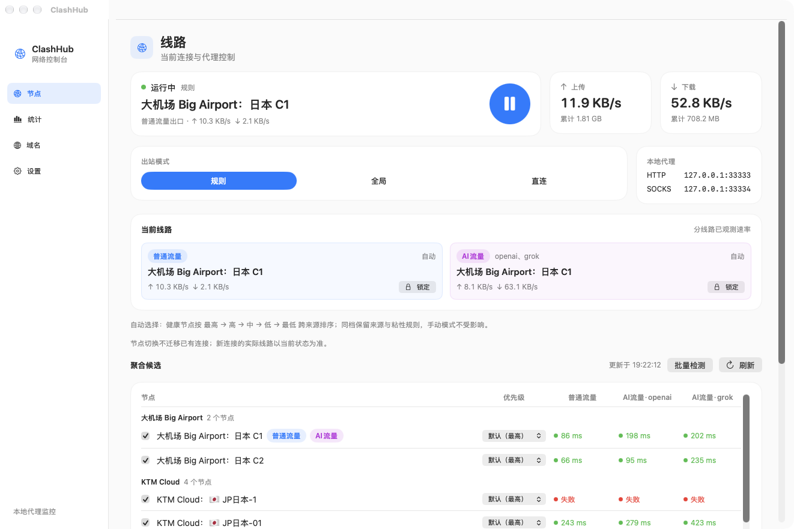
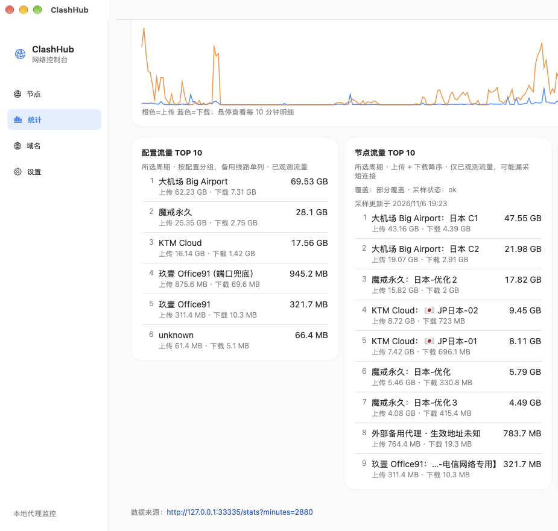

# ClashHub / srhop

[简体中文](README.md) · [English](README.en.md)

macOS 上的**指定地区节点聚合**与选路守护进程，附带菜单栏控制台 **ClashHub**。

它把多个 Clash / FlClash 配置里符合地区条件的节点（默认日本）聚合成一个代理池，按来源优先级和节点健康度自动选路，同时把流量拆成两条互不干扰的通道：

- **普通流量**（内部 `主代理` 选择器）：除 AI 域名外的所有流量
- **AI流量**（内部 `AI主代理` 选择器）：只接管所选 AI 服务商的官方域名（openai / claude / gemini / grok，可多选）

只有候选节点全部明确失败时才回落到本地备用代理（默认 `127.0.0.1:33210`），而不是一生气就切换。

## 界面





> 截图中的机场、节点与流量均为示例，不包含订阅地址或密钥。

## 它解决什么问题

同一个地区往往有多个机场、多份订阅、多个客户端配置。手工在客户端里维护合并规则、优先级和故障切换既繁琐又容易抖动。ClashHub 把这件事收敛成一个本机守护进程：

- 聚合多个来源中**指定地区**的节点，按来源/节点优先级选路；
- 只读使用现有配置，不修改 FlClash 的数据库或配置；
- 普通流量与 AI 流量分开选路、分开统计，避免一个通道的抖动拖累另一个；
- 全部候选失败才使用备用线路，减少无意义的来回切换。

地区由 `aggregate_keywords` 控制，默认匹配日本（日本 / JP / 东京 / 大阪 / Tokyo / Osaka 等），也可以改成其他地区关键词。

### 使用建议：Codex 与 Claude

以下为实践建议，不是硬性限制：

- **Codex**：在同一地区内自动切换出口通常比较安全。它的请求更容忍短暂重连，节点间切换一般不会破坏会话。
- **Claude**：建议在顶部「AI流量」卡片点击**锁定**，固定一个稳定节点。Claude 对出口地区与会话连续性更敏感，频繁自动切换可能触发风控或中断长会话。

两条通道可以分别锁定：普通流量跟随自动选路，AI 流量固定节点，互不影响。

## 特性

- **指定地区聚合**：按关键词聚合日本/其他地区节点，来源与节点都可设五档优先级。
- **只读使用现有配置**：不改 FlClash 数据库与配置；聚合结果、覆盖项、统计都留在 ClashHub 自己的目录。
- **双通道选路**：普通流量与 AI 流量独立选节点、独立健康证据、独立统计。
- **按真实域名分流**：AI 通道只匹配所选服务商的官方域名后缀，不劫持共享 CDN 或身份提供商域名。
- **多目标探测**：普通通道依次尝试多个探测目标，任一成功即视为可用；AI 通道对每个已选服务商逐一探测，全部通过才算健康。
- **五档优先级 + 临期提级**：`highest / high / medium / low / lowest`；订阅剩余有效期不足 3 天自动提 1 级、不足 1 天提 2 级；支持按节点名关键词降级。
- **节点锁定**：顶部两张线路卡片可一键锁定当前节点，再点解锁恢复自动切换。
- **粘性选择**：自动模式下只有当前节点明确失败才更换；手动选择立即生效，不等待探测。
- **更新配置**：按订阅地址重新拉取全部来源，**先直连、失败再用当前代理**，带真实百分比进度。
- **统计与诊断**：节点健康网格、配置/节点流量排行、24 小时域名 TOP 10、历史域名累计（不随 48 小时窗口丢失）、每页 20 条翻页、自定义屏蔽域名。
- **来源管理**：自动发现 FlClash 配置；可编辑订阅地址；自定义订阅可删除（同步清理缓存并重建引擎）。
- **可选本机模块**：本地加密配置离线导入默认关闭，在设置中勾选后启用；项目不包含任何密钥。
- **菜单栏 GUI**：当前节点、双通道速率、重置时间、任务状态一屏可见。

## 架构

```
应用 / 浏览器
      │  系统代理（HTTP 33333 / SOCKS 33334）
      ▼
  srhop 守护进程 ──────────────► 统计与本地 API（127.0.0.1:33335）
      │  普通流量 → 主代理
      │  AI 域名   → AI主代理
      ▼
  mihomo 引擎（混合端口 33301，控制器 19090）
      │  JP-ALL / JP-<source> 候选池
      ▼
  节点（来自各配置来源）
      │  全部失败时
      ▼
  备用地址（默认 127.0.0.1:33210，可配置多个）
```

| 端口 | 用途 |
| --- | --- |
| `127.0.0.1:33333` | HTTP 代理（系统代理指向这里），也承载节点控制 API |
| `127.0.0.1:33334` | SOCKS5 代理 |
| `127.0.0.1:33335` | 统计 / 来源 / 诊断 API（Bearer token） |
| `127.0.0.1:33301` | mihomo 混合端口（仅本机） |
| `127.0.0.1:19090` | mihomo 控制器（仅本机） |
| `127.0.0.1:33210` | 默认备用代理（外部进程，不由本项目启动） |

## 快速开始

### 依赖

- macOS 14 或更高（GUI 使用 SwiftUI）
- Xcode Command Line Tools（`swiftc`，编译 GUI 时需要）
- [mihomo](https://github.com/MetaCubeX/mihomo)：`brew install mihomo`
- Python 3 与 PyYAML（生成引擎配置）：`python3 -m pip install pyyaml`
- Go 1.24+（仅编译时需要）
- 可选：使用本机加密配置导入时，另需 Python `cryptography`

### 编译并运行

```bash
git clone https://github.com/gptzm/clashhub.git && cd clashhub
go build -o srhop .

./srhop on       # 接管系统代理并启动守护进程
./srhop status   # 查看当前模式、上游、探测延迟
./srhop off      # 停止并恢复原有系统代理
```

首次运行会在 `~/Library/Application Support/srhop/` 生成 `config.json`。默认 `sources` 为空，需要加入至少一个配置或订阅：

- 已安装 FlClash 时，URL 类型配置会被自动发现并登记；
- 也可以在 GUI「设置 → 机场配置」里添加本机 YAML 路径或订阅地址。

其他命令：

```bash
./srhop serve       # 前台运行守护进程（调试用）
./srhop retry       # 立即重新探测引擎
./srhop update      # 重新生成节点配置并热加载
./srhop logs        # 最近日志
./srhop doctor      # 一次性诊断
```

### 菜单栏 GUI

```bash
# 先在仓库根目录构建守护进程；build.sh 会把它一起打进 app
go build -o srhop .

cd gui
./build.sh                    # 生成 gui/ClashHub.app
./build.sh ~/Applications     # 或直接装到 ~/Applications
open ClashHub.app
```

GUI 只通过本机 `127.0.0.1:33335` 的带 token API 与守护进程通信，不监听外部地址。

### 生成安装包（DMG / ZIP）

```bash
./gui/package.sh
# 产物：dist/ClashHub-<版本>.dmg 和 dist/ClashHub-<版本>.zip
```

安装包内嵌了守护进程与 `gen_config.py`，安装后的 ClashHub.app 可双击直接启动，不依赖 `~/srhop` 目录。mihomo 与 Python/PyYAML 仍是运行依赖，不会被一起打包。

安装包使用临时签名（ad-hoc）。首次启动如被 Gatekeeper 拦截，请右键 → 打开，或执行：

```bash
xattr -dr com.apple.quarantine /Applications/ClashHub.app
```

## 使用流程

1. **添加机场**：打开 ClashHub → 设置 → 机场配置 → 添加机场，粘贴订阅地址（或让 FlClash 配置被自动发现）。
2. **选择地区**：来源卡片里的包含关键词默认是日本（日本 / JP / 东京 / 大阪），按需要修改。
3. **更新配置**：点「更新配置」拉取全部订阅，先直连、失败后走当前代理，界面显示百分比。
4. **选节点**：线路页的聚合候选按来源分组；优先级默认跟随来源，可逐节点下拉覆盖；点「锁定」固定当前节点。
5. **AI 流量**：设置 → AI 线路检测里勾选服务商；建议给 Claude 锁定固定节点，Codex 可在同地区内自动切换。
6. **看统计**：统计页看配置/节点/域名 TOP 10；域名页看历史域名累计并添加黑名单。

## 配置

配置文件：`~/Library/Application Support/srhop/config.json`

| 字段 | 说明 |
| --- | --- |
| `sources` | 来源列表：`id`、`label`、`type`（`profile` / `subscription` / `vpn`）、`path` 或 `url`、`enabled`、`default_priority`、包含/排除关键词 |
| `aggregate_keywords` | 地区聚合关键词，默认日本；留空则按来源筛选结果聚合 |
| `ai_targets` | AI 通道接管哪些服务商，如 `["openai","grok"]`；探测与分流规则随之变化 |
| `fallback_addrs` | 备用代理地址，按顺序尝试；`fallback_addr` 兼容旧版，始终是第一个 |
| `primary_strategy` / `ai_strategy` | `stability`（默认，故障才切换）/ `latency` / `balanced` |
| `probe_interval_sec` / `probe_timeout_sec` | 节点探测周期与超时 |
| `subscription_refresh_hours` | 订阅刷新周期（默认 6 小时） |
| `vpn_guard` | 检测到这些 VPN 客户端在运行时，不抢占系统代理 |

节点优先级可在 GUI 中逐节点调整，也可以在 `/api/node-priorities` 写入覆盖项；覆盖项与自动降级规则分开保存，来源排序变化不会丢失手调结果。

### 运行时文件

| 路径 | 内容 |
| --- | --- |
| `~/Library/Application Support/srhop/mihomo/config.yaml` | 生成的 mihomo 配置（含密钥，权限 0600） |
| `~/Library/Application Support/srhop/api-token` | 本地 API token，首次运行随机生成 |
| `~/Library/Application Support/srhop/stats.json` | 健康、流量与历史域名累计（节点名做哈希） |
| `~/Library/Application Support/srhop/sources/` | 订阅缓存（0600，不进入版本库） |
| `~/Library/Logs/srhop.log` | 守护进程日志 |
| `~/Library/Logs/mihomo.log` | 引擎日志 |

## 健康与选路模型

1. 每轮扫描向 mihomo 控制器查询候选节点，只探测聚合组内的节点，避免把全量节点拖进探测窗口。
2. 普通通道按「配置的探测 URL → 备用目标」顺序尝试，任一成功即健康；AI 通道对每个已选服务商执行一条或多条必需检查。
3. mihomo 对节点侧失败返回 `503`，控制器自身过载也可能返回 `503`。本项目按响应体区分二者：前者记为节点失败，后者记为结果不确定，不会误判成节点死亡。
4. 证据有效期是探测周期的 2 倍；超过即标记为「旧」，不参与选路。
5. 自动模式优先停留在当前健康节点；只有出现明确失败才按「来源优先级 → 节点优先级 → 延迟」选择下一个，全部失败才使用备用地址。
6. 手动选择（锁定）不等待探测，立即写入选择器；随后再异步验证实际路径。

## 安全与隐私

- 所有监听地址都是 `127.0.0.1`；本地 API 需要随机生成的 Bearer token，并校验请求来源，拒绝跨站请求。
- 订阅地址、token、节点凭据不会写入日志或错误文本；配置与缓存文件权限为 `0600`。
- 对 FlClash 数据库只做只读查询，不写入、不迁移、不删除。
- 可选的本机导入模块只处理用户显式选择的本地文件，不联网、不提取他人凭证；请自行确认使用方式符合相关客户端条款。
- 仓库不包含任何订阅、节点、账号或密钥；首次运行全部本地生成。
- 本项目不收集遥测。

## 开发

```bash
gofmt -l .
go vet ./...
go test ./...                    # 单元与集成测试
python3 test_gen_config.py       # 配置生成器测试
python3 gui/test_labels.py       # GUI 文案/解码测试（需要 Swift 工具链）
cd gui && ./build.sh /tmp/check  # GUI 构建检查
```

主要文件：

| 文件 | 职责 |
| --- | --- |
| `main.go` | CLI 入口与子命令 |
| `app.go` | 守护进程生命周期、系统代理接管与恢复 |
| `engine.go` | mihomo 配置生成、校验、热加载 |
| `gen_config.py` | 从来源 YAML 生成 mihomo 配置 |
| `node_health.go` | 节点探测、健康判定、选路 |
| `node_selection.go` | 选择器操作与本地 API |
| `node_diagnostics.go` | 诊断快照与手动扫描 |
| `node_traffic_service.go` | 节点流量采样 |
| `source_runtime.go` / `source_discovery.go` | 来源拉取、缓存与自动发现 |
| `route_traffic.go` | 普通流量 / AI 流量字节拆分 |
| `gui/main.swift` | ClashHub 菜单栏应用 |

## 推荐机场

以下为个人使用过的机场，按价格/稳定性大致排序。链接含邀请码，介意可去掉后缀直接访问官网。价格、套餐与可用地区会变化，请自行确认后再购买：

- **大飞机场（超低价）**：https://xn--mesr8b36x.com/#/register?code=If2YOX8t
- **KTM 机场（低价）**：http://134.175.54.55:33333/#/register?code=8ieaDNJF
- **魔戒（较稳定）**：https://43.129.78.33:8000/register?aff=diRnqrqC
- **玖壹机场（较稳定）**：https://103.118.40.221:49145/?invite_code=pbxHlaNj

> 本项目不运营、不背书任何机场，也不提供订阅或节点。请只购买你所在地区允许使用的服务，并遵守服务商条款。

## 许可证

[MIT](LICENSE)。宽松许可：允许商用、修改、再分发，只需保留版权与许可声明。

## 免责声明

本项目不提供任何订阅或节点，也不附带绕过付费或鉴权的能力。请只使用你有权使用的配置与服务，并遵守当地法律与服务商条款。项目与 mihomo、FlClash 及各服务商无隶属关系。
